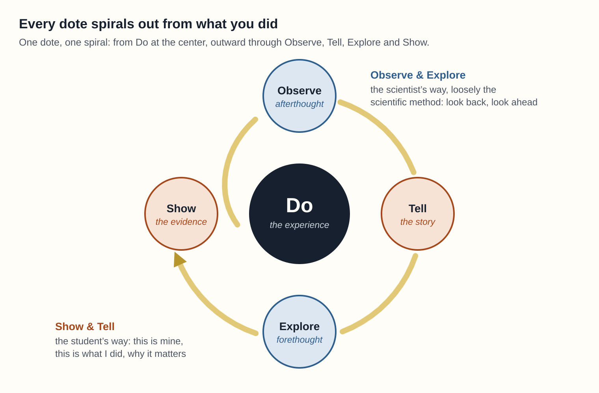

# Dotes

**Record what you learned by living it, in your own words, in a form AI can read.**

[dotes.xyz](https://dotes.xyz) · [michael@intospatia.xyz](mailto:michael@intospatia.xyz)

Dotes is an open framework for first-person learning stories. A dote is a single story of growth, told in five parts: **Do, Observe, Tell, Explore, Show.** Over time, a person's dotes form a map of where they've been and who they're becoming.

<p align="center"></p>

Every dote is a spiral around what you did. It starts at **Do** and moves outward through Observe, Tell, Explore and Show. It joins two ways people have always learned: the student's **Show and Tell**, and the scientist's **Observe and Explore**, loosely the scientific method. Observe is afterthought, the look back. Explore is forethought, the look ahead.

This repository holds everything you need to read it, try it and build with it: the canon, 63 sample dotes from three fictional people, starter prompts, a JSON schema, and a kit for building your own Dotes explorer on Playlab or ChatGPT.

> AI Representatives should be cultivated from the lived experiences and self-authored meaning of the people they represent, rather than assembled from inferences about them.

## Why this is open

We count clicks, hours and badges with great precision. We almost never ask people what their experiences meant. As AI systems build profiles of us from whatever they can infer, the people being described need a way to author their own record.

Dotes is a gift: a base layer for digital civilization, open to everyone, name included. Nothing here is proprietary.

Dotes won't be argued into existence. It will be practiced into existence, by people who try it, build on it and break it. That's what this repository is for.

## What's here

| Folder | What's inside |
| --- | --- |
| [`canon/`](canon/) | The canonical framework in Markdown and Word: the definition, the five elements, seven categories, 35 subcategories, stewardship rules, glossary and starter prompts; plus description of dotes framework provenance. |
| [`personas/`](personas/) | Three fictional people, Melu (13), Jessi (20) and Cyrus (69), and their 63 dotes, as Markdown and a spreadsheet |
| [`data/`](data/) | The same 63 dotes as JSON and CSV, plus every category and subcategory as JSON |
| [`schema/`](schema/) | A JSON Schema for a single dote |
| [`explorer/`](explorer/) | Instructions, upload files, and a setup and testing guide for a Dotes Explorer, plus links to working examples on Playlab and ChatGPT |
| [`session/`](session/) | The first public session, at MeasureCamp DC in November 2026: slides, speaker notes, handout and session card |
| [`tools/`](tools/) | A validator that checks dotes against the schema and the canon |

## Start in five minutes

1. Read sections 1 to 3 of the [canon](canon/Dotes_Canonical_Framework.md).
2. Open a persona, such as [Jessi](personas/Dotes_Persona_Jessi.md), and read three of her dotes.
3. Write one of your own with the starter prompts in Part 2 of the canon. Paper is fine.
4. Check the sample data against the schema:

```bash
pip install jsonschema
python tools/validate.py data/dotes.json
```

## Things to build

- **An explorer** on any AI platform, starting from [`explorer/`](explorer/).
- **A dote editor** that starts wherever the memory is strongest: a photo, a voice note, an object, or a conversation with someone who writes it down.
- **Prompts for a new audience**: a new age group, language, profession or setting. The 35 intents stay fixed; the wording is yours.
- **A translation** of the canon.
- **New fictional personas** in the same format, especially from lives the current three don't cover.
- **A look at the lenses.** How do the seven categories overlap across the 63 sample dotes? What would a thousand dotes look like, without reading a single one?
- **A Rep demonstration** that drafts only from dotes the author allows, and cites the dote behind every claim.
- **A bridge to learning records**: a way for a dote to travel alongside a credential or a learning and employment record.
- **A stress test.** Break the schema and tell us what's missing.

When you build something, open an issue with the **I built something** template so others can find it.

## Ground rules

Dotes is about people's own stories, so a few rules come before any code.

- **Fictional or consented data only.** Never post a real person's dotes in an issue, pull request or demo, and never a young person's.
- **The person holds the meaning.** A tool may help with the medium. It never presents its guesses as the author's words.
- **Keep the nine commitments.** The canon asks anything that carries the Dotes name to keep the commitments in its section 10.
- **Canon changes start as a conversation.** Open an issue before proposing a change to the canon. Prompts, personas, tools and translations are open for pull requests.

More in [CONTRIBUTING.md](CONTRIBUTING.md).

## License

- **Canon, personas, prompts, data and docs:** [Creative Commons Attribution 4.0 International](LICENSE) (CC BY 4.0). Use, share and adapt them, including commercially, as long as you give credit.
- **Code (the schema and tools):** [MIT](LICENSE-CODE).
- **The name "Dotes":** free for anyone to use, for any purpose, including commercial use, with no permission or fee needed. Call your app, course, program, research or product Dotes. CC BY 4.0 doesn't cover names on its own, so this grant is made here, in plain words, as part of the same release. No need to ask, but if you build something, tell us at [michael@intospatia.xyz](mailto:michael@intospatia.xyz).

The canon asks that anything carrying the name keep its nine commitments. That is a shared promise, not a condition of the license.

Suggested credit: *"Dotes" by Michael Robbins, licensed under CC BY 4.0.*

The sample personas and everyone in their stories are fictional. Any resemblance to real people is coincidental.

---

Created by Michael Robbins · [dotes.xyz](https://dotes.xyz) · [michael@intospatia.xyz](mailto:michael@intospatia.xyz) · [linkedin.com/in/mwrxyz](https://www.linkedin.com/in/mwrxyz)
