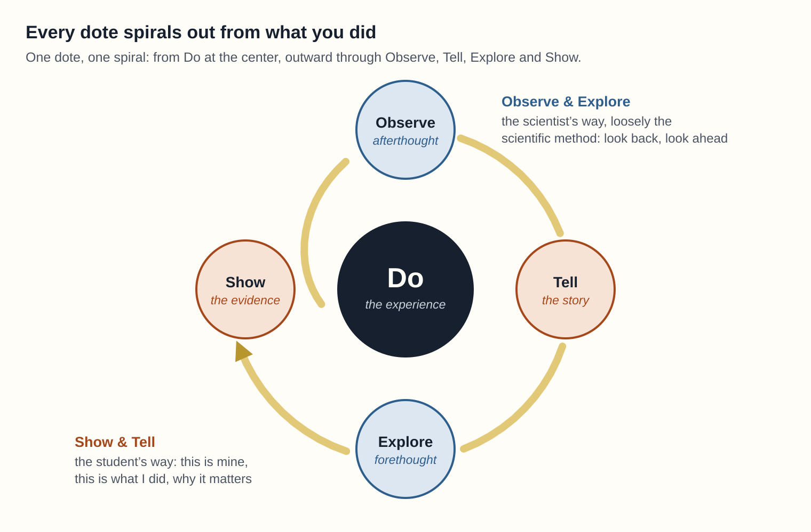

# Dotes: Canonical Framework

**By Michael Robbins** · [michael@intospatia.xyz](mailto:michael@intospatia.xyz) · [dotes.xyz](https://dotes.xyz)  
Free to use and adapt under [CC BY 4.0](https://creativecommons.org/licenses/by/4.0/), the name "Dotes" included.

Dotes is a way to record what you learned by living it, in your own words. It holds that the AI that represents you should grow from those stories, rather than from guesses about you.

# Part 1. The Canon

## 1. The canonical statement

Dotes rests on one definition, two propositions, one distinction and one deeper proposition. Each appears below in its formal wording, then in plain English.

### The definition

> **Dotes:** An AI-ready narrative ontology for the first-person recordation of lived learning experiences. Axiomatic to narrative and relational identity development and the cultivation of AI Representatives.

**In plain English:** Dotes is a shared way to put your own learning stories on the record, in your own words, in a form AI can understand. Three things are built on those stories: knowing who you are, showing who you are to others, and raising an AI that represents you.

Four words in the definition carry weight:

- **Narrative ontology.** An ontology is a shared vocabulary with fixed meanings, so people and machines mean the same thing by the same word. This one is built for stories.
- **Recordation.** Putting something on the record, the way a deed is recorded. The record shows who made it and when.
- **Axiomatic.** An axiom is a starting point that other things are built on.
- **AI-ready.** Structured so AI can read and connect a story without rewriting it.

### The two propositions

**1. What Dotes is**

> A structured, first-person means of recording lived experience, preserving meaning, authorship, and provenance in a form AI can interpret.

**In plain English:** A dote is your story, told by you. It keeps three things together: what the experience meant to you, the fact that you are the one who told it, and a record of where it came from.

**2. What Dotes makes possible**

> A foundational architecture for developing narrative identity, expressing relational identity, and cultivating enduring AI Representatives.

**In plain English:** Over time, your dotes help you see who you are becoming. They help you show other people who you are. And they are what an AI Representative is raised from, one that lasts and grows with you across your life.

### What "axiomatic" means here

> Dotes is not a prerequisite for human identity formation. It establishes the foundational primitives through which identity can be represented, developed, and carried forward in an AI ecosystem.

**In plain English:** People have always come to know who they are through family, faith, work, friendship and the stories they tell. They do not need Dotes for that. Dotes provides the basic building blocks for carrying that identity into a world where AI is part of daily life. (Primitives are the smallest building blocks a system is made from, the way letters are for writing.)

### The deeper proposition

> AI Representatives should be cultivated from the lived experiences and self-authored meaning of the people they represent, rather than assembled from inferences about them.

**In plain English:** Most AI today learns about people by tracking what they click, buy and search, then guessing. Dotes proposes a different source: what a person actually lived, and what they say it meant. *Cultivated* is a gardener's word for something grown over time from its own roots. *Assembled* is a factory word for parts put together from outside.

## 2. Dotes in plain English

A dote is a single story of growth: something you did, what you noticed, how you would tell it, where it leads, and what makes it real. Over time, your dotes form a map of where you've been and who you're becoming.

### Where it comes from

Dotes descends from show-and-tell. Most of us learned it sitting on a classroom rug: hold something up, and tell its story. Three sentences carried the whole practice:

*This is mine. This is what I did. This is why it matters.*

It also draws on the way scientists learn: look closely at what happened, then explore what to try next. Section 3 shows how the two fit together.

Dotes joins the two and gives them a structure that lasts. The name comes from its five elements: **D**o, **O**bserve, **T**ell, **E**xplore, **S**how. "Dotes" with a capital D is the framework, and it takes a singular verb. "A dote" is one story.

### What a dote can hold

A dote can begin with anything a person lived through: a win, a mistake, a loss, a hard conversation, an illness, a change of heart. What makes it a dote is that it tells what the person did with that experience and what they learned. The learning can be a question that is still open.

Dotes are told from strength. A failure becomes a dote when the person tells what it taught them.

### Who it is for

Dotes is for anyone who learns by living, at any age: a ten-year-old after a science fair, a teenager after a first job, an adult changing careers, a grandparent passing on what they know. This canon is written so students, families, teachers, partners and engineers can all read the same page.

### The bridge between living and telling

Learning happens in life: at school, at work, at home, with friends, in hard moments and good ones. Telling comes later, when we need our stories: for an application, an interview, a new team, our families or ourselves.

Dotes is the bridge between the two. It records learning the way we live it, connected to the rest of our lives, and keeps it ready to tell when we need it. One dote can become an interview answer, a portfolio entry or a résumé line, while the full story stays underneath.

## 3. The five elements

Every dote has the same five parts, in the same order. Each part asks one main question.

| Element | The question | What it holds |
| --- | --- | --- |
| **Do** | What happened, and what did you do? | The facts: where, when, who was there, and your part in it |
| **Observe** | What went well, what didn't, and what did you learn? | Your reflection, including feelings, even mixed or surprising ones |
| **Tell** | How would you tell it to someone else? | The story itself, in your voice, with the details and the turning point a listener would remember |
| **Explore** | What would you do differently, and what are you still wondering? | Where it leads: a next step you intend, and the questions still open |
| **Show** | What makes it real? | Evidence: a photo, an object, a drawing, a video, a quote, or someone's account, shared with their permission |

### The spiral

A dote is a spiral around what you did. It starts at the center with Do, the experience, and moves outward through Observe, Tell, Explore and Show. Each turn widens the circle of meaning around the same experience.

### Two traditions in one shape

Dotes joins two ways people have always learned. The student's way is show-and-tell: hold something up and say what it means. The scientist's way, loosely the scientific method, is to observe closely and explore what to try next. Together they run from intuitive storytelling to careful inquiry, and learners of every age use both.

| Element | Tradition | What it does |
| --- | --- | --- |
| **Do** | The center | The experience itself, where both traditions begin |
| **Observe** | The scientist | Afterthought: looks back at what happened and what it taught |
| **Tell** | The student | Puts the experience into words for someone else |
| **Explore** | The scientist | Forethought: looks ahead to what to try next and what is still open |
| **Show** | The student | Holds up the evidence that makes it real |

### Afterthought and forethought

Every dote holds both. Observe is afterthought, the look back. Explore is forethought, the look ahead. Do sits between them, in the moment it happened, and Tell and Show carry it out to other people.

### Do and Tell are different

Do is the record: what happened, stated plainly. Tell is the telling: the version you would share at dinner, with the line someone said and the moment it turned.

A good test for Tell: *What is the one detail someone would remember if you told them this story?* If Tell only repeats Do, it needs a scene. If Tell explains the lesson, that part belongs in Observe.

### Meaning grows across all five

Meaning develops through all five parts: in what you notice, how you tell it, where it leads and what you choose to show. The machine helps with the medium. The person holds the meaning.

### Ways to start a dote

A dote does not have to begin as writing. Start wherever the memory is strongest.

- **Start with Show.** Begin with a photo, an object, a drawing or something you made, then work back to the story.
- **Say it out loud.** Record a voice note and shape it later.
- **Tell it to someone.** A partner, teacher or AI helper can write it down as you talk. You approve the final words.
- **Use any language.** Tell it in the language the experience happened in, or the one you think in.
- **Leave parts open.** Show can stay empty until there is something to show. Observe can change as you look back.
- **Skip any question.** No prompt is required.

These options help everyone. They are essential for people who find writing hard, are still learning the language, or communicate in other ways.

## 4. Two worked dotes

These two examples show complete dotes. The first comes from a school project. The second comes from a summer job, a kind of learning that often goes unrecorded.

### The robot arm

| Element | The dote |
| --- | --- |
| **Do** | Two days before our class showcase, the arm on our robot snapped at the elbow joint. My partner Maya and I stayed after school both days to rebuild it. |
| **Observe** | We rushed the first design and never tested the joint with weight on it. We solved problems faster when we talked an idea through before anyone picked up a tool. I was the one who had been rushing. |
| **Tell** | "The arm cracked on our last practice run. You could hear it. Maya looked at me and said, 'Okay. What did we skip?' Neither of us wanted to answer. That night we laid every part out on a cafeteria table and went through them one at a time. The fix was simple: a brace and a slower motor. The hard part was admitting the first version failed because I didn't want to wait." |
| **Explore** | Next time I will test each part with weight before we put it together. I also want to ask our mentor how engineering teams keep track of design decisions. |
| **Show** | Photos of the cracked joint and the rebuilt one, the revised sketch, a short video of the arm lifting at the showcase, and a note from Maya about what happened, shared with her permission. |

### The summer job

| Element | The dote |
| --- | --- |
| **Do** | My first summer job was junior counselor at a recreation center day camp. In week two, two eight-year-olds started shoving over the kickball, and I had to handle it before the senior counselor got back. |
| **Observe** | Taking the ball away made them both angrier. What worked was separating them and letting each one tell me what happened without being interrupted. Being fair and being in charge turned out to be different things. |
| **Tell** | "Jaylen was crying and Marcus kept yelling, 'He cheated!' I grabbed the ball, and they both turned on me. So I sat Jaylen on the bench, walked Marcus to the water fountain and asked him what happened. Then I asked Jaylen. Same story: each of them thought it was his turn. That afternoon we made a rule. Whoever lost the last round picks first. By Friday the kids were enforcing it themselves." |
| **Explore** | Next summer I want to apply for senior counselor. I am curious how teachers and coaches learn to settle arguments, and I want to ask mine. |
| **Show** | A photo of the rule on the camp whiteboard, a short note from the senior counselor, and my end-of-summer evaluation. |

### One dote, many uses

Later, the summer job dote can become a two-minute interview answer for the senior counselor job. It can also become a résumé line: *Junior counselor, recreation center day camp. Settled conflicts between campers and set a turn-taking rule the campers adopted.* The full story stays underneath, in the author's own words.

## 5. The seven categories

The seven categories are lenses. Each asks a different question of a story, so one dote can be seen through more than one. The five elements structure each dote; the seven categories connect dotes across a life.

| Category | Focus | The lens question |
| --- | --- | --- |
| **Character** | Values and choices | What was at stake, what did you choose, and what did the choice reveal? |
| **Excellence** | Effort and achievement | What were you working toward, and what happened along the way? |
| **Service** | Care and contribution | Who or what did you help, and what did you take responsibility for? |
| **Relationships** | Connection and belonging | What happened between you and others, and how did the connection change? |
| **Adventure** | Exploration and discovery | What was new to you, and what did it open up? |
| **Making** | Creation and craft | What did you bring into being, how did you make it, and why did it matter? |
| **Wellbeing** | Health and balance | What affected your health or balance, and what did you learn about living well? |

### Definitions and boundaries

Each category has one definition. Each boundary names a common misreading so it can be avoided.

**Character.** Experiences in which values are tested or expressed through a choice: honesty, courage, empathy, fairness, responsibility. *Boundary:* Character is not a moral score. A dote about a mistake, a regret or a change of mind can be among the most important a person tells.

**Excellence.** Experiences of setting a goal or standard and working to reach it, in school, sports, the arts, leadership or work. *Boundary:* Excellence is not about being better than other people. Falling short, changing goals or deciding to stop can still show real growth.

**Service.** Experiences of helping, caring for, teaching, speaking up for or protecting people, communities, places or causes. *Boundary:* Service is not measured in volunteer hours, and it is not limited to helping someone "less fortunate." Mutual aid, listening, caring for family and sharing power all count.

**Relationships.** Experiences in which connections with family, friends, mentors, teammates or communities form, deepen, break or are repaired. *Boundary:* This lens is about what happens between people, including conflict, distance, grief and reconciliation. The other person is part of the story.

**Adventure.** Experiences of curiosity and first encounters: a new subject, place, culture, skill or way of seeing. *Boundary:* Adventure does not require travel, money or danger. A library book, a new neighborhood or a new school can open the world.

**Making.** Experiences of designing, building, writing, composing, performing, coding, repairing or crafting something, alone or with others. *Boundary:* Making is broader than art and does not require an original invention. Repairs, remixes, performances and group projects all count.

**Wellbeing.** Experiences of caring for body, mind and spirit: movement, food, rest, emotional balance, purpose and connection to nature. *Boundary:* Wellbeing does not judge bodies, food, feelings or rest. Dotes about health and emotions are private by default (see section 9).

**A note on disability.** People with disabilities tell dotes in all seven categories, like everyone else. Disability is not a topic within Wellbeing. Accessibility belongs to how dotes are made (see "Ways to start a dote" in section 3).

### Choosing a primary category

- **The author chooses.** Ask: *What part of this experience do I most want to keep?* The answer points to the primary category.
- **Add others only when they are really there.** A secondary category should name a meaning the story already holds.
- **Suggestions stay suggestions.** An AI helper may propose categories. Each stays labeled as a suggestion until the author accepts it.
- **Change it any time.** What a story means can shift as a life goes on.

### The two examples, through the lenses

| Lens | The robot arm | The summer job |
| --- | --- | --- |
| Character | **Primary.** Admitting I had been rushing | Taking charge before the senior counselor returned |
| Excellence | Getting the arm ready for the showcase | Doing a first job well |
| Service | Not in the story as told | Caring for younger children |
| Relationships | How Maya and I learned to work together | **Primary.** Settling the conflict between two campers |
| Adventure | Not in the story as told | Not in the story as told |
| Making | Designing and rebuilding the arm | Not in the story as told |
| Wellbeing | Not in the story as told | Not in the story as told |

Most dotes fit two to four lenses. A lens that does not fit stays empty, because forcing it would invent a meaning the author never gave.

## 6. The 35 subcategories

Each category has five subcategories, and each subcategory has one intent: the kind of moment it asks for, in plain words. Prompts for different ages are written from these intents. Starter prompts for all 35 subcategories are in Part 2.

### Character

| Subcategory | Intent: a time you... |
| --- | --- |
| Integrity and Honesty | told the truth or kept your word when it cost you something |
| Courage and Resilience | did something hard or frightening, or kept going after a setback |
| Empathy and Compassion | worked to understand what someone else was going through, and acted on it |
| Responsibility and Accountability | owned a mistake and made it right, or carried a responsibility others relied on, including at home |
| Ethical Reflection and Growth | changed your mind about what was right or fair, and why |

### Excellence

| Subcategory | Intent: a time you... |
| --- | --- |
| Academic and Intellectual Achievement | worked hard to understand or master something, in school or on your own |
| Creative and Artistic Achievement | worked to reach a standard in an art, craft or performance |
| Athletic and Physical Achievement | trained or pushed yourself toward a physical goal |
| Leadership and Initiative | started something, or led others toward a goal |
| Work and Enterprise | learned by working, earning or running something: a job, a business, a family enterprise |

### Service

| Subcategory | Intent: a time you... |
| --- | --- |
| Community Service and Mutual Aid | helped meet a need in your community, alone or with others |
| Environmental Stewardship | acted to care for a place, land, water or animals |
| Mentorship and Support | helped someone else learn, grow or get through something |
| Advocacy and Civic Action | spoke up or acted to change something for others |
| Inclusion and Kindness | made room for someone who was left out or treated unfairly |

### Relationships

| Subcategory | Intent: a time you... |
| --- | --- |
| Friendship and Peer Support | began or deepened a friendship, or a friend helped you through something |
| Family and Generations | connected with family or across generations, including caring for a family member |
| Mentorship and Guidance | were guided by someone older or more experienced, and what you did with it |
| Community and Teamwork | were part of a group that worked toward something together |
| Conflict and Repair | worked through a disagreement, made peace, forgave or were forgiven |

### Adventure

| Subcategory | Intent: a time you... |
| --- | --- |
| Intellectual Curiosity | followed a question into learning something new |
| New Places and New Beginnings | went somewhere new or started over: a trip, a neighborhood, a new school, a move |
| Creative Exploration | tried a way of creating that was new to you |
| Cultural Encounter and Exchange | met a culture, language or tradition new to you, or shared your own |
| Skills and Hobbies | took up a skill or hobby and stayed with it long enough to learn |

### Making

| Subcategory | Intent: a time you... |
| --- | --- |
| Visual Art and Craft | made something visual or by hand: a drawing, painting, sculpture, garment or craft |
| Music and Performance | composed, rehearsed or performed music, dance, theater or spoken word |
| Writing and Storytelling | wrote or told something that mattered to you |
| Invention, Design and Repair | designed, built or fixed something to solve a problem |
| Digital Creation | made something with digital tools: a video, game, app, website, track or online community |

### Wellbeing

| Subcategory | Intent: a time you... |
| --- | --- |
| Movement and Physical Activity | took up or stayed with a way of moving your body, or came back after an injury or a break |
| Food and Nourishment | cooked, shared or learned about food: a family recipe, a meal for others, a tradition |
| Emotional Balance | found your way through a hard feeling, or helped yourself steady |
| Rest and Renewal | made room for rest or recovery and noticed what it gave you |
| Personal and Spiritual Development | connected with something larger than yourself: faith, nature, purpose or a big question |

Dotes in Emotional Balance and Personal and Spiritual Development are private by default. Prompts in those two subcategories are always optional.

## 7. Identity: who I am, and who we are together

Dotes serves two kinds of identity. Together they answer three questions: *Who am I? Who are you? Who are we together?*

### Narrative identity: who am I?

*Narrative identity* is the story a person tells about how they became who they are. It is built from single stories: turning points, lessons, moments a person keeps coming back to.

Dotes adds three things to that story:

- **It is authored.** The person decides what each experience meant.
- **It is kept.** Patterns can be seen years later, across many dotes.
- **It can be revised.** The meaning of an experience can change as a life goes on.

### Relational identity: who are you, and who are we together?

Relational identity is who we are with and to other people: a daughter, a teammate, a neighbor, a mentor. A first-person story can still center someone else. The author tells the account, but a friendship, a family or a team can be its real subject.

Shared dotes also help groups come together. Groups tend to move through four stages.

| Stage | What is happening | How dotes help |
| --- | --- | --- |
| Forming | People are getting to know each other | Introducing yourself beyond a résumé or a list of facts |
| Storming | Friction and disagreement surface | Understanding why someone reacts the way they do |
| Norming | The group agrees how it will work | Finding common ground in shared stories |
| Performing | The group works well together | Knowing each other well enough to trust and mentor |

### Across a life: the three Acts

The same five elements and seven categories work at every age. What changes is the wording of the prompts and the kinds of stories people tend to tell.

| Act | Ages | What dotes often hold |
| --- | --- | --- |
| First Act | Childhood through the teen years | Firsts, and the building of a foundation |
| Second Act | Twenties through forties | Work, relationships, choices and purpose |
| Third Act | Fifties and beyond | Reflection, mentoring and passing things on |

## 8. AI Representatives

An AI Representative, or Rep, is an AI that belongs to one person, is bound to act in that person's interest, and is raised from that person's own dotes. Its duty to the person is like a trustee's: it works for them and answers to them.

### Cultivated, rather than assembled

| | Assembled from inferences | Cultivated from dotes |
| --- | --- | --- |
| **Source** | Data trails: clicks, purchases, searches, location | What the person lived, in their own words |
| **Who decides what it means** | The system, by guessing | The person |
| **Can the person see it?** | Rarely | Always |
| **Can the person correct it?** | Rarely | Yes, at any time |
| **What a judgment traces back to** | Patterns no one can point to | Specific dotes the person can read |

### A traceable line of meaning

Because dotes are authored rather than guessed, a Rep can point to the stories behind what it says. Suppose a Rep describes someone as a person who stays calm in a conflict. It should be able to show the summer job dote that supports that.

The person can then agree, add context or take it back. A judgment that can be traced can be questioned, and that keeps the person in charge of their own story.

### What a Rep does first

At the start, a Rep has one job: helping a person tell their own stories for school, work and life. That might mean drafting an application essay from three dotes, preparing for an interview, or building a portfolio. The person approves anything before it goes out.

### What AI may and may not do

The governing principle: **the machine helps with the medium; the person holds the meaning.**

AI **may**:

- help a person remember details and shape a story
- organize, search and connect dotes
- suggest categories, patterns and questions, labeled as suggestions
- translate a dote, or turn it into another form such as an essay, an answer or a slide

AI **may not**:

- rewrite a dote and present it as the person's own words
- turn its guesses into facts on the record
- let one moment stand for the whole person
- use a dote the person has not allowed it to use
- send anything on the person's behalf without their approval

### A Rep exists because a person exists

An AI Representative exists because a human exists. It does not stand on its own, or outlive the person it represents. Dotes is concerned with people. It makes no claim that AI is or will become conscious; the Rep is an extension of a person's standing in a digital world.

## 9. Stewardship: keeping dotes safe

A dote belongs to the person who told it. The rules below protect that ownership, protect the other people who appear in stories, and keep young people safe.

### Ownership

- Your dotes are yours. You can read, change, export and delete them at any time.
- You can take all of them with you when you leave a school, program or app, in a format other tools can read.

### Who can see a dote

| Level | Who can see it | When it is the default |
| --- | --- | --- |
| Just me | Only the author | Every new dote |
| People I choose | Specific people the author names, such as a teacher, parent or mentor | Never automatic |
| My group | A class, team or cohort the author belongs to | Never automatic |
| Public | Anyone with the link | Never automatic |

A Rep may use a dote only when the author allows it. That permission starts off for dotes about health, emotions, faith, family circumstances or something the author regrets doing.

### Other people in your story

- **Tell your side.** A dote records your experience, rather than a verdict on someone else.
- **Protect identities.** Use first names or roles, such as "my coach" or "a classmate." Leave out details that would identify someone who has not agreed to be in the story.
- **Ask before quoting.** Another person's words in Show, such as a note, a quote or a video of them, need their permission.
- **Keep records separate.** A dote about someone never becomes part of that person's record.
- **No reporting on others.** Prompts never ask a person to confess or to report someone else's wrongdoing.

### Young people and safety

- Young people make dotes inside the safeguarding rules of their school or program. Adults keep every duty they already have to report harm.
- Before they begin, young people are told in plain words that some things, such as someone being hurt or in danger, must be passed to a trusted adult.
- If a story suggests that someone is being harmed or is at risk, an AI helper stops and hands off to a trusted adult. It never handles that alone.
- No prompt is required, and any question can be skipped. Prompts about faith and family are always optional.
- Families are told how dotes are used, who can see them and how to have them removed.

### Revision, history and deletion

- **The current version governs.** When an author revises a dote, the Rep uses the new version.
- **History is the author's.** Earlier versions are kept only if the author wants them, and only the author can see them.
- **Deletion is real.** Deleting a dote removes it. Anything a Rep drew from it is marked as no longer supported, and the Rep stops using it.

These rules keep two promises at once. A Rep's judgments can be traced to their source, and the person stays in control of that source.

### Suggestions stay labeled

- Anything an AI suggests, such as a category, a summary or a pattern, is marked as a suggestion until the author accepts it.
- Only the author's words, or words the author approves, become part of the record.
- Every dote keeps its provenance: who told it, when, and what has changed since.

## 10. Canonical commitments

Nine commitments hold everything above. Any tool, program or prompt that carries the Dotes name keeps all nine.

1. **A dote is a first-person story of growth.** It begins with something a person lived and tells what they did with it.
2. **Every dote has five elements:** Do, Observe, Tell, Explore and Show, in a spiral around Do that joins the student's Show and Tell with the scientist's Observe and Explore.
3. **The seven categories are lenses.** The author chooses which apply, and one story can carry several.
4. **The person holds the meaning.** AI helps with the medium and never presents its guesses as the person's words.
5. **Dotes belong to their authors.** People can read, revise, export and delete them, and decide who sees them.
6. **Other people are protected.** No one's words or private details enter someone else's dote without their permission.
7. **Young people are kept safe.** Dotes work inside the safeguarding rules of every school and program that uses them.
8. **AI Representatives are cultivated, not assembled.** They grow from authored dotes, and their judgments can be traced back to them.
9. **Dotes is a foundation, not a requirement.** People form identities without it; Dotes gives identity a lasting, authored form in a world with AI.

## 11. Glossary

| Term | Plain meaning |
| --- | --- |
| Afterthought | Looking back at what happened and what it taught; the work of Observe |
| AI-ready | Structured so AI can read and connect a story without rewriting it |
| AI Representative (Rep) | An AI that belongs to one person, acts in their interest and is raised from their dotes |
| Assembled | Put together from outside data and guesses |
| Authorship | Being the one who told the story and who decides what it means |
| Axiomatic | Serving as a starting point that other things are built on |
| Category (lens) | One of seven questions you can ask of a story |
| Cultivated | Grown over time from a person's own stories, with care |
| Do, Observe, Tell, Explore, Show | The five elements of every dote (section 3) |
| dote | One story told through the five elements |
| Dotes | The framework as a whole; takes a singular verb ("Dotes is") |
| Fiduciary duty | A duty to act in someone else's best interest, like a trustee's |
| Forethought | Looking ahead to what to try next; the work of Explore |
| Inference | A guess a machine makes from patterns in data |
| Intent | The kind of moment a subcategory asks for |
| Life Acts | Three broad stages of a life: First, Second and Third Act |
| Narrative identity | The story a person tells about how they became who they are |
| Observe and Explore | The scientist's way of learning, loosely the scientific method |
| Ontology | A shared vocabulary with fixed meanings and defined connections, so people and machines mean the same thing |
| Primary category | The lens the author chooses as the heart of a story |
| Primitives | The smallest building blocks a system is made from |
| Provenance | Where something came from: who made it, when, and what has changed |
| Recordation | Putting something on the record, with who made it and when |
| Relational identity | Who a person is with and to other people |
| Show and Tell | The student's way of learning: hold something up and say what it means |
| Spiral | The shape of a dote: from Do at the center, outward through Observe, Tell, Explore and Show |
| Subcategory | A more specific kind of moment within a category |

## Open to everyone

Dotes is a gift, offered as a base layer for digital civilization. Everything in this canon, its starter prompts and its sample materials is released under the Creative Commons Attribution 4.0 International license (CC BY 4.0). Anyone may use, share and adapt them for any purpose, including commercial use, with credit to Michael Robbins.

The name comes with it. Anyone may call their tool, program, course or research "Dotes" without asking permission or paying a fee. The canon asks one thing of anything that carries the name: that it keep the nine commitments in section 10.

Find everything, and join in, at [dotes.xyz](https://dotes.xyz). Write to Michael Robbins at [michael@intospatia.xyz](mailto:michael@intospatia.xyz).

# Part 2. Starter Prompts

These prompts open a dote. Each one leads into the five elements, starting with Do: what happened, and what did you do?

Written for ages 10 and up, from the subcategory intents in section 6.

## How these prompts are written

1. **Start with doing.** Each prompt asks about a moment and what you did in it. Feelings come next, in Observe.
2. **One moment.** A prompt asks for a single time, rather than a habit or a description of yourself.
3. **Anyone can answer.** No prompt assumes money, travel, lessons, a quiet room or a particular kind of family.
4. **Start from strength.** Hard experiences are welcome, told as what they taught.
5. **No confessions, no reporting.** No prompt asks a person to admit wrongdoing or to report on someone else.
6. **Every prompt is optional.** Skip any of them. Prompts about faith, feelings and family are always optional.
7. **Name the listener when it matters.** Say whether the story is for yourself, a partner, a teacher or the group.

## One intent, written for different ages

The intent stays the same; the words change. Here is Integrity and Honesty: *a time you told the truth or kept your word when it cost you something.*

| Who is answering | The prompt |
| --- | --- |
| Younger children | When did you tell the truth even though it was hard? |
| Teens (First Act) | When did being honest cost you something: a friendship, a grade, a chance to fit in? |
| Adults (Second Act) | When did doing the right thing at work or at home cost you something? What did you decide? |
| Elders (Third Act) | Which moment of honesty shaped you most? What did it cost, and what did it give you? |

## After any prompt

Once a person picks a moment, the same five questions follow.

| Element | Follow-up question |
| --- | --- |
| Do | What happened, and what did you do? |
| Observe | What went well, what didn't, and what did you learn? |
| Tell | How would you tell it to a friend? What is the one detail they would remember? |
| Explore | What would you do differently, and what are you still wondering? |
| Show | What could you share that makes it real? |

## Character

*What was at stake, what did you choose, and what did the choice reveal?*

### Integrity and Honesty

- When did you tell the truth even though a lie would have been easier?
- When did you keep a promise that turned out to be hard to keep?
- Have you ever found, or been handed, something that wasn't yours? What did you do?

### Courage and Resilience

- When did you stand up for someone, or for what was right, when others stayed quiet?
- What is something you did even though it scared you?
- Think of a setback you came back from. What did you do to keep going?

### Empathy and Compassion

- When did you notice someone was struggling and do something about it?
- When did you change how you treated someone after you understood their side?
- When did you give something up so someone else could have it?

### Responsibility and Accountability

- Think of a mistake you owned up to. How did you make it right?
- What do people count on you for, at home, at school or at work? Tell about a day it really mattered.
- When did you take care of someone in your family, like watching a younger sibling or translating for a relative?

### Ethical Reflection and Growth

- When did you change your mind about something after learning more?
- What hard choice taught you something about yourself?
- When did you think about what was fair for everyone, not just for you?

## Excellence

*What were you working toward, and what happened along the way?*

### Academic and Intellectual Achievement

- What subject or problem did you struggle with until it finally clicked? What did you do to get there?
- What project are you proud you finished? What was the hardest part?
- What did you teach yourself because you wanted to understand it?

### Creative and Artistic Achievement

- What piece did you practice or rework until it met your own standard?
- Tell about getting ready for a performance, show or exhibit.
- When did feedback on your creative work help you get better?

### Athletic and Physical Achievement

- What physical goal did you train for? What did the training look like?
- Tell about a game, race or match where you gave everything you had, win or lose.
- What new move or skill did you work to learn with your body?

### Leadership and Initiative

- What did you start that other people joined?
- When did you organize people to get something done?
- When did you keep a group going after things got hard?

### Work and Enterprise

- What did you learn at a job, paid or unpaid?
- When did you earn money by making, selling or doing something?
- Tell about work other people depended on you for: a family business, a side job or work at home.

## Service

*Who or what did you help, and what did you take responsibility for?*

### Community Service and Mutual Aid

- When did you help meet a need in your neighborhood or community?
- When did people around you pitch in to help each other? What was your part?
- What did you work on that made a place you care about better?

### Environmental Stewardship

- What did you do to care for a park, a garden, a stream or animals?
- What habit did you change to waste less, and what happened?
- When did you show someone else how to care for a place?

### Mentorship and Support

- When did you help someone learn something you know how to do?
- When did you help a younger student, teammate or sibling through something hard?
- What advice did you give that actually helped someone? What happened next?

### Advocacy and Civic Action

- When did you speak up about something that wasn't fair?
- When did you work with others to change a rule, a decision or a situation?
- What did you do after you learned about a problem in your community or the world?

### Inclusion and Kindness

- When did you make sure someone who was left out got included?
- When did you welcome someone new?
- When were you kind to someone others were treating unfairly?

## Relationships

*What happened between you and others, and how did the connection change?*

### Friendship and Peer Support

- How did one of your friendships begin?
- When did a friend help you through something hard, or you helped them?
- What did you and your friends build, plan or figure out together?

### Family and Generations

- What did an older family member teach you? How did they teach it?
- What family tradition do you help keep going? What is your part?
- When did you care for someone in your family, or they cared for you, in a way you still remember?

### Mentorship and Guidance

- Which teacher, coach or mentor changed how you saw something? What did they do?
- What advice did you get, what did you do with it, and what happened?
- When did an older student or sibling help you get through something challenging?

### Community and Teamwork

- When did a group you were part of do something none of you could have done alone?
- What was your role in a group project, and how did the group work together?
- Where do you feel you truly belong? Tell about one day there.

### Conflict and Repair

- Think of a disagreement with a friend or family member that you worked through. How did you do it?
- When did you help two people make peace?
- When did you apologize to someone, or forgive someone? What changed afterward?

## Adventure

*What was new to you, and what did it open up?*

### Intellectual Curiosity

- What question couldn't you stop asking, and where did it lead you?
- What book, video or conversation made you want to learn more? What did you do next?
- What puzzle or problem did you figure out on your own?

### New Places and New Beginnings

- What place near where you live did you explore for the first time?
- Tell about starting somewhere new: a new school, a new group or a new home.
- Where did you go, near or far, that showed you something you had never seen?

### Creative Exploration

- When did you try a kind of creating you had never done before?
- What did you experiment with, just to see what would happen?
- What game, story or world did you invent?

### Cultural Encounter and Exchange

- When did you learn a tradition, food, language or celebration that was new to you?
- When did you share something from your own culture with other people?
- When did you try to speak or understand a language you were still learning?

### Skills and Hobbies

- What hobby did you start, and what kept you going?
- What skill did you practice until you got noticeably better?
- What club or group did you join because of something you love doing?

## Making

*What did you bring into being, how did you make it, and why did it matter?*

### Visual Art and Craft

- What did you draw, paint, sculpt, sew or build by hand that matters to you?
- What piece was hard to make, and how did you finish it?
- Where did the idea for one of your pieces come from?

### Music and Performance

- What song, dance, scene or poem did you write, learn or rehearse?
- Tell about performing for other people. How did you get ready?
- When did you make music or a performance with others?

### Writing and Storytelling

- What did you write that you are proud of, and what inspired it?
- What letter, speech or message did you write that really mattered?
- When did a story you told change how someone saw something?

### Invention, Design and Repair

- What did you design or build to solve a problem?
- What broken thing did you figure out how to fix?
- What first try failed, and what did you change?

### Digital Creation

- What video, game, app, website or track did you make with digital tools?
- What did you build inside a game or an online world?
- What online group or channel did you start or help run? What did running it teach you?

## Wellbeing

*What affected your health or balance, and what did you learn about living well?*

Dotes from Emotional Balance and Personal and Spiritual Development are private by default, and every prompt here can be skipped.

### Movement and Physical Activity

- What way of moving your body did you start or stick with: a sport, dance, walking or play?
- What physical challenge did you work up to? How did you prepare?
- Tell about getting back to something you love after an injury or a long break.

### Food and Nourishment

- What did you cook or prepare for yourself or for others?
- What family recipe or food tradition do you know? Who taught it to you?
- Tell about a meal you shared that brought people together.

### Emotional Balance (optional)

- What have you found that helps you through a hard day? How did you find it?
- When did you talk something through with someone you trust?
- How did you get through a stressful moment, and what would you do again?

### Rest and Renewal

- When did you choose to rest, and what did it give you?
- What routine helps you recharge? How did you build it?
- Where do you feel calm, and what do you do there?

### Personal and Spiritual Development (optional)

- When did you feel connected to something larger than yourself?
- What big question about life have you wondered about, and where did it lead you?
- What tradition, practice or place in nature helps you feel grounded?

