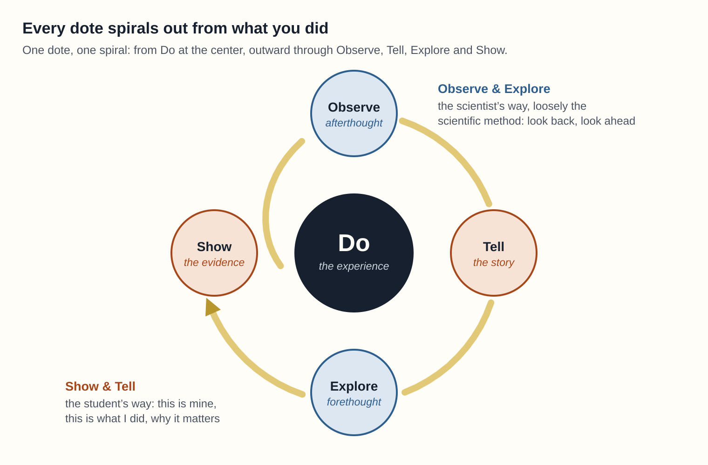

# 525,600 Minutes: How Do You Measure a Year?

A 30-minute discussion session at MeasureCamp DC, Saturday, November 7, 2026, Georgetown University's Capitol Campus, Washington, D.C.

Led by Michael Robbins · [michael@intospatia.xyz](mailto:michael@intospatia.xyz) · [dotes.xyz](https://dotes.xyz)

> We count clicks, hours and badges. Who measures what people learn by living? A discussion about data people write themselves, AI-built identities, and who should own the evidence.

**Level:** All · **Type:** Discussion · **Focus:** Analytical

## The idea

We've become extraordinarily good at measuring what people do inside our systems. We almost never ask them what it meant. In an age of AI, that gap matters: if people can't author their own narrative identities, AI systems will build identities for them through inference.

## Run of show

| Time | What happens |
| --- | --- |
| 0:00–0:03 | The 525,600 hook, then a show of hands: who knows last month's sessions? Who knows what one visitor learned? |
| 0:03–0:08 | Quick write: one thing you learned this year that no system recorded. Two volunteers share. |
| 0:08–0:14 | Dotes in five minutes: the definition, the five elements, the spiral, the two traditions (Show and Tell, Observe and Explore), one example, and the comparison with STAR and Kolb |
| 0:14–0:17 | In pairs: turn your card into a Do and an Observe |
| 0:17–0:27 | Discussion: three of the five questions below |
| 0:27–0:30 | Close: "What if the evidence belonged to the person who lived it? Keep your card. It's yours." |

## Discussion questions

1. What is the unit of measurement for meaning? Can a story be data without losing what makes it a story?
2. If people author the record, what happens to validity? Is self-report the flaw, or the point?
3. What could you count across a thousand dotes without reading anyone's story?
4. Who should own learning evidence: the institution, the platform or the person?
5. Once stories count, will people perform them? How would you design against that?

## The spiral

Every dote is a spiral around what the person did. It starts at Do and moves outward through Observe, Tell, Explore and Show. It joins two ways of learning: the student's Show and Tell, and the scientist's Observe and Explore, loosely the scientific method. Observe is afterthought, the look back; Explore is forethought, the look ahead.

## STAR, Kolb and Dotes

| | STAR | Kolb's learning cycle | Dotes |
| --- | --- | --- | --- |
| **Built for** | Answering one interview question | Describing how people learn from experience | Recording what one person learned, in their own words |
| **Shape** | A line: Situation, Task, Action, Result | A loop: experience, reflection, forming ideas, trying them out | A spiral around Do, joining Show and Tell with Observe and Explore |
| **Leaves behind** | One answer for one listener | Nothing; it's a model, not a record | A lasting, revisable record the person owns |

## Materials

| File | What it is |
| --- | --- |
| [`slides.pdf`](slides.pdf) | The 18 slides, 16:9 |
| [`speaker-notes.md`](speaker-notes.md) | What to say on each slide, with timings |
| [`handout.pdf`](handout.pdf) | The two-sided handout, US Letter: the five elements and the spiral on the front; the seven lenses, STAR, Kolb and Dotes, and a "try one" space on the back |
| [`session-card.pdf`](session-card.pdf) | The session card for the MeasureCamp board, US Letter landscape |

Use them, remix them and run the session yourself. All of it is free to use and adapt under [CC BY 4.0](https://creativecommons.org/licenses/by/4.0/), the name "Dotes" included. Credit: *"Dotes" by Michael Robbins, michael@intospatia.xyz, dotes.xyz.*
